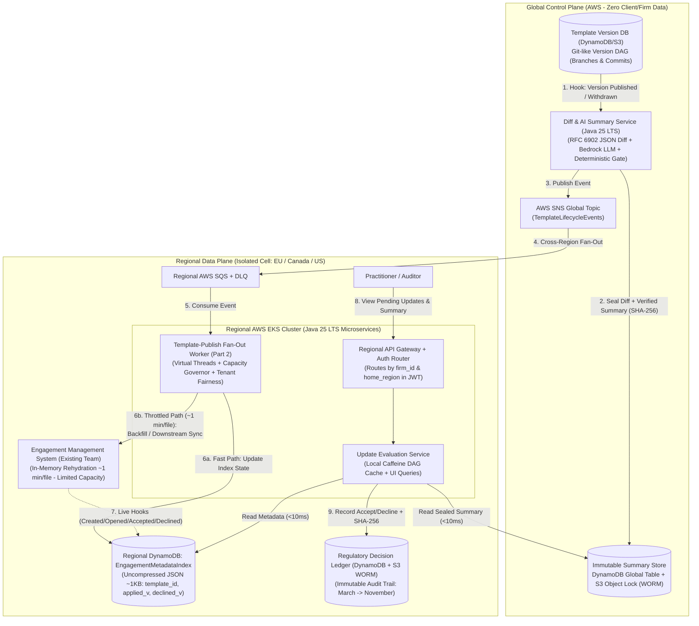

# Architecture Design Document: Product Template Update Evaluation & Notification System
**Author:** Daniel Julián Gómez Silva — *Staff Java Software Developer Candidate*

---

## 1. Architecture and Data Ownership

To satisfy strict contractual and regulatory **Data Residency** requirements (`EU`, `Canada`, `US`) while sharing non-confidential product templates across `4,000` firms, the architecture separates a **Global Template Control Plane** from isolated **Regional Engagement Data Planes** (`eu-central-1`, `ca-central-1`, `us-east-1`).

### System Boundaries & Data Ownership
| Data Domain | Owner Service | Backing Store & Scope | Data Residency & Privacy Boundary |
| :--- | :--- | :--- | :--- |
| **Template Version Graph (DAG), JSON Diffs & Verified AI Summaries** | *Global Template & Summary Service* | **DynamoDB Global Tables + S3 WORM** (Read-only replicas in each region). | **Global:** Contains zero firm or engagement data (`0% PII / Client Workpapers`). |
| **Engagement Version Metadata (`EngagementMetadataIndex`)** | *Regional Update Evaluation Service* | **Regional DynamoDB** (Uncompressed JSON header `~1 KB` per engagement). | **Strictly In-Region (`EU`, `Canada`):** Never leaves the regional boundary. Routed at authentication via JWT (`firm_id`, `home_region`). |
| **Engagement File Workpapers & Volatile Financial State** | *Engagement Management System (Existing Team)* | Firm-isolated storage + Session Pods (~1 min load constraint). | **Strictly In-Region:** Our system never inspects workpaper content or sends client data to an LLM. |
| **Regulatory Decision Audit Trail (`RegulatoryDecisionLedger`)** | *Regional Update Evaluation Service* | **Regional DynamoDB + S3 Object Lock (Compliance Mode)**. | **Strictly In-Region:** Records user, timestamp, decision, and cryptographic hashes of the exact summary and diff reviewed. |

---

## 2. Correctness and Production Evolution

### 2.1. Non-Linear Template Versioning (Git-Like DAG) & What `"Declined"` Pins
Product template versions are modeled as an immutable **Git-like Directed Acyclic Graph (DAG)**. Each node stores `version_id`, `parent_version_ids[]`, `market_branch` (e.g., `CA-IFRS`, `EU-AUDIT`), and `status` (`PUBLISHED`, `WITHDRAWN`). Each market branch maintains an atomic `head_version_id` pointer.

- **What `"Declined"` Actually Pins:**
  - Declining an update does **not** permanently opt out of future updates, nor does it cherry-pick individual JSON fields. A *Decline* pins the specific **transition edge `(engagement_id, base_version: v4, declined_target_version: v5)`** in the regional `EngagementMetadataIndex`.
  - While the branch's active `head` remains `v5`, the predicate `has_pending_update = (applied_version != head) && (declined_target_version != head)` evaluates to `false` (suppressing the pending badge for `v5`).
  - **Accumulating Updates (`v4 -> v5 -> v6 -> v7`):** When `v7` is published on that branch (incorporating `v5`'s changes), `head` becomes `v7 != v5`, re-activating the pending update indicator. Because the engagement never applied `v5`, the user is presented with the **cumulative diff from their actual base version (`v4 -> v7`)**, with the summary UI explicitly distinguishing changes inherited from previously declined `v5` versus new changes introduced in `v6/v7`.
- **Withdrawn Versions (`Withdrawn` Lifecycle):**
  - *Withdrawn before user applies:* A `TemplateVersionWithdrawn(v6)` event moves the branch `head` pointer back to `v5` (or forward to corrective `v7`). Any engagement with a pending evaluation for `v6` immediately sees `v6` removed.
  - *Withdrawn after user already applied `v6`:* We query the regional DynamoDB GSI `(product_template_id, applied_version = v6)` in `< 10 ms` and flag those specific engagements as `REMEDIATION_REQUIRED -> v7`.

### 2.2. Zero-Downtime Migration & Backfill on a Live System
Opening an engagement takes **~1 minute per file** (hard constraint), and all systems are live with no maintenance window. To populate `EngagementMetadataIndex` for the existing `800,000` engagements safely:
1. **Phase 1 — Live Event Piggybacking (Day 1):** We attach hooks (`EngagementCreated`, `EngagementOpened`, `UpdateAccepted`, `UpdateDeclined`) via a *Transactional Outbox* to regional SQS. Every engagement created or opened by practitioners during normal business operations populates its `~1 KB` DynamoDB JSON record with zero extra hydration cost.
2. **Phase 2 — Throttled Background Backfill:** For dormant existing engagements not yet indexed, our `TemplatePublishFanOutWorker` crawls remaining IDs during off-peak hours under a strict concurrency cap (e.g., `100` global concurrent loads across regions), preserving session pod capacity for active users.
3. **Phase 3 — Self-Healing Read Repair:** Whenever an engagement is rehydrated into memory during a user session (~1 min), its actual template version is verified against `EngagementMetadataIndex`, automatically repairing any state drift.

### 2.3. Unreliable Event Delivery & Failure Recovery
- **Transactional Outbox + SNS/SQS with DLQ** guarantees *At-Least-Once* delivery across regions.
- **Idempotency & Monotonic Ordering:** Every metadata record tracks `last_event_seq`. DynamoDB conditional writes (`ConditionExpression: :new_seq > last_event_seq`) reject duplicate or out-of-order deliveries.

---

## 3. Scale, Cost, and Operational Characteristics

### 3.1. Baseline Numbers & Explicit Assumptions
- `4,000` firms | `800,000` active engagements | `40` products $\Rightarrow$ **Average: `20,000` engagements per product**.
- **Firm Size Skew:** Median = `~40` engagements/firm; Largest = `~40,000` engagements/firm (5% of all engagements in a single tenant).
- **Publish Frequency:** `~1 update/week/product` = `40 updates/week` $\approx$ **`173 publishes/month`** (~6 per business day).
- **Explicit Assumption for `«$X»/month`:** We assume a strict budget ceiling of **`$500 USD/month`** and demonstrate an all-in run cost of **`~$216 USD/month`**.

### 3.2. Scale & Latency Arithmetic
1. **Why the 1-minute engagement load cannot be on the critical path of a template publish:**
   - Rehydrating `20,000` engagements for one product publish requires:
     $$20,000 \text{ engagements} \times 1 \text{ min/file} = 20,000 \text{ machine-minutes} \approx 333.3 \text{ machine-hours}$$
   - Even at `50` concurrent calls to the downstream service, wall-clock completion takes **$20,000 / 50 = 400 \text{ minutes} = \mathbf{6.67 \text{ hours}}$**.
2. **Real-Time Evaluation via `EngagementMetadataIndex` (DynamoDB + Local DAG Cache):**
   - **Total Index Storage:** $800,000 \text{ engagements} \times 1 \text{ KB} \approx \mathbf{800 \text{ MB}}$ across all regions.
   - **Propagation & Query Latency:** Publishing a template replicates the new DAG node (`~5 KB`) via SNS/SQS to the regional Java pods' local **Caffeine** cache in **`< 2 seconds`**. When a user opens their dashboard (median `40` engagements, or paginated `100`-item view for the `40,000`-engagement firm), the service queries DynamoDB by `firm_id` and evaluates `(applied_version != branch_head)` in memory in **`p99 < 25 ms`**.
   - Simultaneously, regional background fan-out updates materialized pending flags in DynamoDB for `20,000` items via `BatchWriteItem` at `1,000 WCU` in **$20,000 / 1,000 = \mathbf{20 \text{ seconds}}$**.
3. **One-Time Backfill Arithmetic:**
   - Assuming 30% (`240,000`) of active engagements are opened organically by users over the first 2 weeks (indexed for free via hooks), `560,000` engagements remain. Throttling background hydration to `100` concurrent calls globally during off-peak hours completes in:
     $$\frac{560,000 \text{ machine-minutes}}{100 \text{ concurrent workers}} = 5,600 \text{ minutes} \approx \mathbf{93.3 \text{ hours}} \text{ (~3.9 days or 8 off-peak nights)}$$

### 3.3. All-In Monthly Cost Arithmetic
- **LLM Inference Cost ($O(\text{Version Pairs})$ vs. $O(\text{Engagements})$):**
  - *Naive per-engagement generation:* $173 \text{ publishes/mo} \times 20,000 \text{ engagements} = 3.46\text{M LLM calls/mo} \approx \$34,600\text{/month}$ (Prohibitive).
  - *Our Design:* Templates are not firm-specific. A diff summary between `(template_id, from_v -> to_v)` is identical for every firm on `from_v`. Pre-computing summaries for each of the `173` monthly publishes against the last $K=5$ active versions on that branch yields:
    $$173 \text{ publishes/month} \times 5 \text{ version pairs} = \mathbf{865 \text{ summaries/month}}$$
  - At `~10k` input tokens + `~1k` output tokens on AWS Bedrock (Claude 3.5 Sonnet, including verification pass) $\approx \$0.045\text{/summary}$: **$865 \times \$0.045 = \mathbf{\$38.92 \text{ USD/month}}$**.
- **Storage & Messaging (DynamoDB + S3 WORM + SNS/SQS):** `~6 GB` total storage (`<$2/mo`) + `15M` reads & `5M` writes On-Demand (`~$15/mo`) = **`~$17.00 USD/month`**.
- **Compute (AWS EKS):** 6 lightweight Java 25 LTS pods (`0.5 vCPU, 1 GB RAM` using Virtual Threads, 2 per region across 3 regions) = **`~$160.00 USD/month`**.
- **Total Estimated Monthly Run Cost:** **`~$216 USD/month`** ($\ll \$500\text{/month}$).

### 3.4. Observability & SLOs (New Relic / CloudWatch)
- **SLOs:** (1) Update indicator visibility: `p99 < 5s` after summary verification; (2) Dashboard & summary read latency: `p99 < 150ms`; (3) Downstream capacity adherence: `0` calls exceeding `MAX_CONCURRENCY`.
- **Key Metrics:** `fanout.dlq.depth` (page on `> 0`), `downstream.throttle_429.rate`, `summary.validation.failure_rate`, and `tenant.fairness.max_wait_seconds`.

---

## 4. Generation & Evaluation of Human-Readable Summaries (Regulatory Defensibility)

To ensure AI augments professional judgment with full traceability and can be defended during a **regulatory review in November for a decision made in March**:

1. **Stage 1 — Deterministic Structural Diff Classification (Pure Java):** We extract the exact **RFC 6902 JSON Patch** between `from_v` and `to_v` and deterministically classify every modified path by audit domain (*Formulas/Calculations*, *Audit Checklists*, *Regulatory Disclosures*, *Formatting*), recording exact operation counts (`N`).
2. **Stage 2 — Grounded LLM Synthesis (`temperature = 0` + Strict JSON Schema):** The LLM translates the categorized diff into practitioner-friendly language, but the output schema requires every summary bullet to include `source_diff_paths[]` citing the exact `JSONPath` pointers in the raw diff.
3. **Stage 3 — Automated Verification Gate (Zero-Hallucination Guard):**
   - Deterministic Java validation checks that: (a) **Citation Precision = 100%** (every cited `JSONPath` exists in the raw diff), and (b) **Critical Path Recall = 100%** (zero formula or mandatory audit step changes in the diff were omitted from the summary citations). If validation fails, the pipeline retries once with error feedback or falls back to a deterministic structured change table.
4. **WORM Immutability & Regulatory Audit Trail (March $\rightarrow$ November):**
   - Summaries are **never regenerated on the fly**. In March, the verified summary package (`raw_diff.json`, `rendered_summary.json`, `model_id`, `prompt_version`, `validation_report.json`) is written once to **Amazon S3 with Object Lock (Compliance Mode)** + DynamoDB, sealed with `summary_sha256`.
   - When a practitioner clicks **Accept** or **Decline** in March, the regional `RegulatoryDecisionLedger` writes an immutable record: `(decision_id, engagement_id, user_id, timestamp_utc, action, from_v, to_v, summary_s3_uri, summary_sha256, raw_diff_sha256)`. In November, inspectors retrieve the exact byte-for-byte artifact displayed in March alongside its verifiable links to the underlying template JSON diff.

---

## 5. Key Tradeoffs, Assumptions, and the Challenged Requirement

- **The One Requirement We Challenge (*"Available in real time — within seconds of a template being published"*):**
  - While our `EngagementMetadataIndex` can surface a new version within `< 5 seconds`, **we challenge making a newly published template immediately visible to 4,000 firms within seconds of the publish click**. Product templates update only once a week, and the prompt explicitly notes that **versions are occasionally withdrawn after publication**. Exposing an update within 2 seconds: (1) bypasses the ~15–30 second deterministic verification gate for the AI summary, and (2) eliminates any canary/soak window (e.g., 5–15 minutes) to catch defective publishes before practitioners begin applying them. We recommend a **`< 2 minute` post-verification visibility SLA**.
- **Riskiest Part of the Design to Get Wrong:**
  - **State Drift between `EngagementMetadataIndex` and the Legacy Engagement Store:** If an event is dropped after an engagement applies a template or restores from backup, the index could serve stale version state. We mitigate this via *Transactional Outbox*, monotonic `last_event_seq` optimistic locking, and automatic **Read-Repair** whenever an engagement is opened in a live session.
- **What We Deliberately Chose to Leave Out:**
  1. *Per-engagement LLM summary generation:* Redundant across engagements sharing `(from_v, to_v)`, 1,000x more expensive, and risks exposing client workpapers to an LLM.
  2. *Pre-computing all $O(V^2)$ historical version pairs:* We pre-compute the last $K=5$ versions to `head`; older version jumps are computed *lazily on first request* and then cached immutably.
  3. *Template merge/application engine* (explicitly out of scope) and heavy dedicated clusters (Kafka/Redis) where SNS/SQS + DynamoDB + local Caffeine cache achieve single-digit millisecond latency at a fraction of the operational cost.
